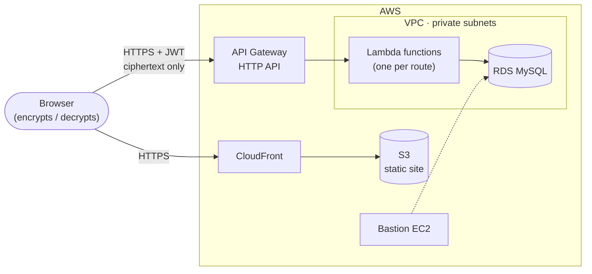

# La Bodega 2.0

**La Bodega is a zero-knowledge password manager.** Credentials are encrypted in the browser before they're sent, using a key that only the user holds. The server stores ciphertext and never sees the key or the plaintext.

This repository is the entry point to the project. The code lives in three repositories: a Vue 3 web client, a serverless TypeScript API on AWS Lambda, and the Terraform that provisions all of it.

🌐 **Live app:** [labodega-dev.velazduran.com](https://labodega-dev.velazduran.com)

## Repositories

| Repository | What it is | Stack |
| --- | --- | --- |
| [**Frontend**](https://github.com/Sinuhe135/La-Bodega-2.0-Frontend) | Single-page web client. Generates the user's key, encrypts and decrypts every credential in the browser. | Vue 3, TypeScript, Vite, Pinia, Web Crypto API |
| [**API**](https://github.com/Sinuhe135/La-Bodega-2.0-API-Node) | Serverless REST API: auth, categories and accounts. One Lambda function per route. | Node.js 20, TypeScript, AWS Lambda, API Gateway, MySQL, JWT |
| [**Infra**](https://github.com/Sinuhe135/La-Bodega-2.0-infra) | Infrastructure as code for the whole system: network, database, API, static hosting, TLS and domains. | Terraform, AWS (VPC, RDS, Lambda, API Gateway, S3, CloudFront, ACM) |

## How it works

### Zero-knowledge by design

There are no passwords. At sign-up the browser generates a random 256-bit key and downloads it as a `.key` file. To log in, the user uploads that file.

- **Login:** only a SHA-256 hash of the key is sent to the API, which hashes it again with bcrypt before storing it. The API returns a JWT.
- **Storing an account:** the email, username, password and platform are each encrypted with AES-CBC (a fresh random IV per value) before the request leaves the browser.
- **Reading accounts:** the API returns ciphertext and the browser decrypts it locally.

The key never leaves the user's device. The trade-off is intentional: if the key file is lost, nobody (including the server operator) can recover the data.

### Architecture



- The **frontend** is a static build served from S3 through CloudFront, with an ACM certificate on a custom domain.
- The **API** is eight small Lambda functions behind an API Gateway HTTP API. Each one is bundled separately with esbuild, so it ships only the code it uses.
- The **database** is MySQL on RDS in private subnets. The Lambdas run inside the VPC to reach it, and a bastion host provides admin access.
- **Terraform** splits the infrastructure into independent stacks (VPC, database, certificates, backend, frontend) that share outputs through remote state in a versioned, encrypted S3 bucket.

## Highlights

- **Client-side cryptography** with the native Web Crypto API, no third-party crypto libraries.
- **Migrated from Express to Lambda.** The API started as a layered Express app. Because the services and repositories didn't depend on Express, the migration only replaced the router/controller layer with per-route handlers.
- **Everything as code.** The full AWS environment can be recreated from the infra repo, with stacks applied in dependency order and secrets passed in as variables, never committed.
- **Typed end to end.** TypeScript in both the client and the API, with shared DTO shapes for every request and response.

## Running it locally

Clone the three repositories side by side. The infra repo expects this layout because it reads build output from the other two.

```bash
git clone https://github.com/Sinuhe135/La-Bodega-2.0.git La-Bodega-2.0-API
git clone https://github.com/Sinuhe135/La-Bodega-2.0-Frontend.git
git clone https://github.com/Sinuhe135/La-Bodega-2.0-infra.git
```

Then follow each repository's README:

1. **API:** point it at a MySQL database, then `npm run build` and `npm run start:dev` (serverless-offline).
2. **Frontend:** set `VITE_API_URL` to the local API, then `pnpm dev`.
3. **Infra** (optional): deploy to your own AWS account with Terraform.

## Roadmap

- Edit and delete for accounts and categories
- Lambda layers for shared dependencies
- RDS-managed database credentials and automated backups
- Lambda deployment packages stored in S3

## Author

Built by [@Sinuhe135](https://github.com/Sinuhe135).
